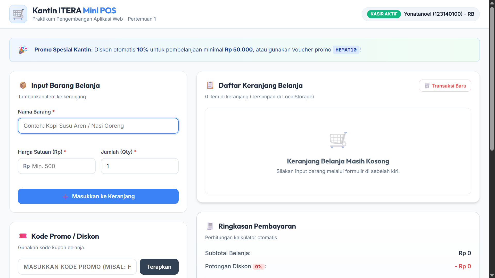
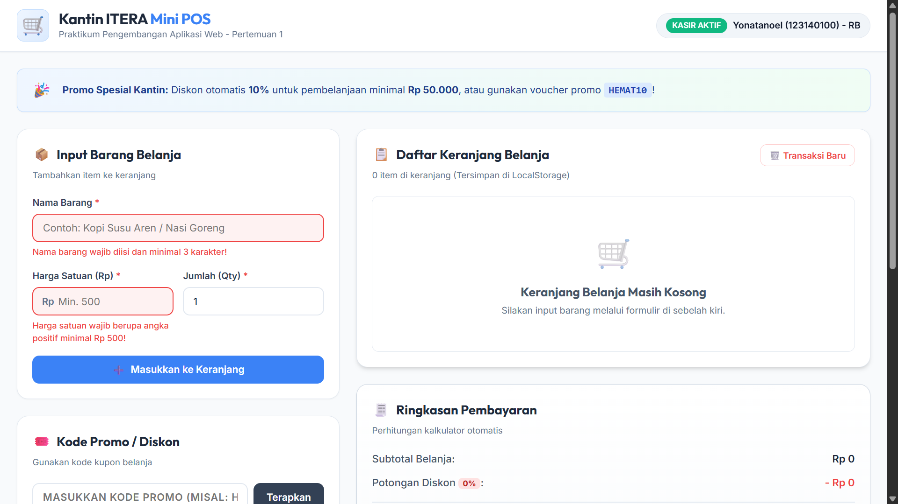
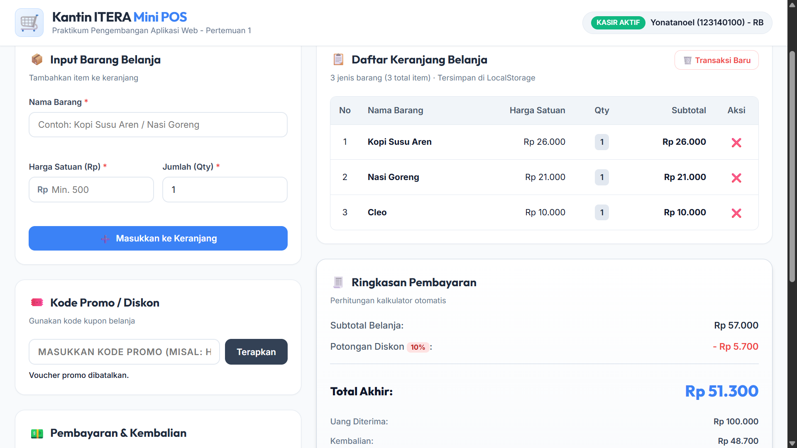

# Tugas Praktikum PAW: Aplikasi Kasir & Keranjang Belanja Sederhana (Mini POS)

Proyek ini dibuat untuk memenuhi tugas **Pertemuan 1: JavaScript Dasar** pada Praktikum Pengembangan Aplikasi Web (PAW), Program Studi Teknik Informatika, Institut Teknologi Sumatera (ITERA).

---

## 📌 Identitas Mahasiswa

| Data | Keterangan |
| :--- | :--- |
| **Nama Lengkap** | Yonatanoel |
| **NIM** | 123140100 |
| **Kelas Praktikum** | RB |
| **Program Studi** | Teknik Informatika |
| **Institusi** | Institut Teknologi Sumatera (ITERA) |

---

## 📖 Deskripsi Aplikasi

Aplikasi **Kantin ITERA Mini POS** adalah aplikasi kasir berbasis web (*Point of Sale*) sederhana yang dirancang khusus untuk kebutuhan transaksi kasir kantin atau toko kampus ITERA. Aplikasi ini mengintegrasikan seluruh kompetensi dasar JavaScript murni (Vanilla JS):
1. **Validasi Form Input Barang**: Menjamin keabsahan input data barang belanja sebelum dimasukkan ke dalam keranjang.
2. **Modul Kalkulator & Perhitungan Finansial Otomatis**: Menghitung subtotal per item, kalkulasi total belanja keseluruhan, kalkulator diskon otomatis (10% untuk belanja $\ge$ Rp 50.000) dan kode voucher promo `HEMAT10`, serta kalkulasi pembayaran tunai dan uang kembalian secara *real-time*.
3. **Manajemen Keranjang Belanja & LocalStorage**: Penyimpanan data keranjang belanja secara persisten menggunakan *browser storage* sehingga keranjang belanja tidak hilang meskipun halaman di-refresh.
4. **Nota Transaksi & Cetak Struk**: Fitur kasir untuk menyelesaikan transaksi dan mencetak bukti pembayaran fisik.

---

## 🚀 Panduan Menjalankan Aplikasi

Aplikasi ini dibangun menggunakan **HTML5, Vanilla CSS, dan JavaScript Native**, sehingga tidak memerlukan instalasi dependensi pihak ketiga atau server backend yang rumit.

### Opsi 1: Menggunakan Live Server di VS Code (Direkomendasikan)
1. Buka folder `yonatanoel_123140100_pertemuan1` di aplikasi **Visual Studio Code**.
2. Pastikan ekstensi **Live Server** (oleh Ritwick Dey) sudah terpasang di VS Code.
3. Klik kanan pada file [`index.html`](file:///c:/Users/yonat/Music/Tugas%20PAW/yonatanoel_123140100_pertemuan1/index.html) dan pilih **"Open with Live Server"**.
4. Browser akan terbuka otomatis di alamat `http://127.0.0.1:5500/` atau `http://localhost:5500/`.

### Opsi 2: Membuka File Langsung di Web Browser
1. Buka File Explorer dan arahkan ke direktori `yonatanoel_123140100_pertemuan1/`.
2. Klik ganda (*double click*) pada file [`index.html`](file:///c:/Users/yonat/Music/Tugas%20PAW/yonatanoel_123140100_pertemuan1/index.html).
3. Halaman aplikasi akan langsung berjalan di browser default Anda (Chrome, Edge, Firefox, dll).

### Opsi 3: Menggunakan Python HTTP Server
Jalankan perintah berikut pada terminal di dalam folder proyek:
```bash
python -m http.server 8080
```
Buka browser dan akses alamat `http://localhost:8080/`.

---

## ✨ Daftar Fitur & Checklist Pemenuhan Kriteria

- [x] **1. Validasi Form Input Barang**:
  - [x] *Nama Barang*: Wajib diisi dan minimal 3 karakter (contoh: "Kopi Susu Aren", "Buku Tulis").
  - [x] *Harga Satuan*: Wajib berupa angka positif minimal Rp 500 (mencegah nilai $\le 0$, NaN, atau kosong).
  - [x] *Jumlah / Qty*: Wajib bilangan bulat minimal 1 (mencegah desimal dan nilai $\le 0$).
  - [x] *Feedback Validasi*: Menampilkan pesan teks berwarna merah tepat di bawah field input yang bermasalah, menandai batas input dengan warna merah, serta mencegah item masuk ke keranjang belanja saat data tidak valid.
  - [x] *Form Reset Otomatis*: Form tereset secara bersih dan fokus kursor kembali ke input nama saat penambahan berhasil.
  
- [x] **2. Modul Kalkulator & Perhitungan Otomatis**:
  - [x] *Kalkulasi Subtotal*: Dihitung per baris dengan rumus $\text{Subtotal} = \text{Harga Satuan} \times \text{Qty}$.
  - [x] *Kalkulasi Total Belanja*: Menjumlahkan seluruh subtotal dalam keranjang belanja secara otomatis menggunakan metode array `reduce`.
  - [x] *Kalkulator Diskon Sederhana*:
    - Otomatis memberikan potongan 10% jika total belanja mencapai minimal Rp 50.000.
    - Tersedia input voucher promo `HEMAT10` yang memberikan diskon 10% dengan tombol *Terapkan* dan *Batal*.
    - Menampilkan nominal potongan diskon dan total akhir yang harus dibayar.
  - [x] *Kalkulator Pembayaran & Kembalian*:
    - Input nominal uang bayar yang diterima dari pembeli.
    - Tombol *Quick Cash* praktis: "Uang Pas", "Rp 10.000", "Rp 20.000", "Rp 50.000", dan "Rp 100.000".
    - Perhitungan kembalian otomatis *real-time*: $\text{Kembalian} = \text{Uang Bayar} - \text{Total Akhir}$.
    - Status peringatan berwarna merah jika uang bayar belum mencukupi ("Uang Kurang" dan nominal kekurangan).
    - Status lunas berwarna hijau jika uang bayar mencukupi beserta nominal kembalian.

- [x] **3. Manajemen List Keranjang & LocalStorage**:
  - [x] *Tabel Keranjang Belanja*: Kolom `No`, `Nama Barang`, `Harga Satuan`, `Qty`, `Subtotal`, dan `Aksi`.
  - [x] *Status Keranjang Kosong*: Menampilkan ilustrasi dan teks ramah saat keranjang kosong.
  - [x] *Aksi Hapus Item*: Tombol hapus pada setiap baris item yang secara reaktif menghapus data dan memperbarui perhitungan belanja.
  - [x] *Penyimpanan Persisten (LocalStorage)*: Diserialisasi menggunakan `JSON.stringify()` saat menyimpan dan diparse dengan `JSON.parse()` saat aplikasi dimuat, menjamin data tidak hilang saat browser dimuat ulang (*refresh*).
  - [x] *Tombol Transaksi Baru / Reset*: Menghapus seluruh isi keranjang dan membersihkan *LocalStorage*.

- [x] **4. Fitur Tambahan (Bonus)**:
  - [x] Modal struk/nota pembayaran kasir yang dapat dicetak (*print layout ready*).
  - [x] Notifikasi pesan *toast* interaktif untuk setiap aksi pengguna.
  - [x] Akumulasi Qty jika nama barang yang sama diinputkan kembali.

---

## 📸 Tangkapan Layar (Screenshot Tampilan)

> **Catatan Pengumpulan**: File gambar screenshot disimpan di dalam folder [`screenshots/`](file:///c:/Users/yonat/Music/Tugas%20PAW/yonatanoel_123140100_pertemuan1/screenshots).

### 1. Tampilan Form Input Utama & Antarmuka Aplikasi
Halaman antarmuka utama Mini POS dengan layout 2 kolom yang responsif, menampilkan formulir penambahan barang, kode voucher, modul pembayaran, tabel keranjang, dan ringkasan finansial kasir.



---

### 2. Tampilan Validasi Error Muncul
Tampilan saat pengguna menekan tombol *Masukkan ke Keranjang* dengan input kosong atau nilai yang tidak memenuhi ketentuan (misal nama < 3 karakter, harga < 500, atau qty < 1). Pesan peringatan merah muncul di bawah masing-masing input.



---

### 3. Tampilan Hasil Perhitungan Kalkulator & Tabel Riwayat Data
Tampilan ketika barang telah ditambahkan ke dalam keranjang, perhitungan diskon otomatis/promo aktif, input uang pembayaran dimasukkan, dan sistem menghitung kembalian secara *real-time* serta siap mencetak struk transaksi.



---

## 🛠️ Penjelasan Teknis Singkat

### 1. Penanganan Validasi Input Form
Logika validasi diimplementasikan pada fungsi `validateItemInput(name, price, qty)`:
- Nama barang diperiksa dengan method `.trim()` untuk memastikan tidak hanya spasi kosong dan memiliki panjang minimal 3 karakter.
- Harga satuan diperiksa dengan `isNaN()` dan syarat `price >= 500`.
- Qty diperiksa dengan `Number.isInteger(qty)` dan syarat `qty >= 1`.
- Jika salah satu kondisi tidak terpenuhi, fungsi menambahkan kelas CSS `.input-error` untuk memberikan highlight visual border merah dan mengisi teks error spesifik pada elemen `.error-msg` di bawah input terkait.
- Jika lolos validasi, formulir di-reset dengan `formItem.reset()` dan kursor langsung diarahkan kembali ke input nama barang melalui `itemNameInput.focus()`.

### 2. Algoritma Kalkulator Keuangan & Pembayaran
Perhitungan finansial dikelola secara tersentralisasi pada fungsi `calculateTotals()` dan `updatePaymentAndChange()`:
- **Total Belanja**: Dihitung menggunakan fungsi agregasi `reduce()` pada array `cart`:
  ```javascript
  const totalBelanja = cart.reduce((sum, item) => sum + (item.price * item.qty), 0);
  ```
- **Diskon**: Logika diskon memeriksa kondisi ganda:
  ```javascript
  if (totalBelanja >= 50000) {
    discountRate = 0.10; // Diskon otomatis 10%
  } else if (appliedPromo === "HEMAT10") {
    discountRate = 0.10; // Diskon kode voucher promo
  }
  ```
- **Kembalian Real-time**: Event listener `input` pada elemen `cash-amount` menghitung selisih secara instan:
  $$\Delta = \text{cashAmount} - \text{grandTotal}$$
  Jika $\Delta < 0$, sistem menampilkan status *"Uang Kurang"* dan mengunci tombol checkout. Jika $\Delta \ge 0$, status berubah menjadi *"Lunas"* dan tombol checkout diaktifkan.

### 3. Mekanisme Serialisasi LocalStorage
Data keranjang belanja diserialisasi secara aman:
- **Penyimpanan**: Setiap kali terjadi mutasi pada state keranjang (`cart.push()`, `cart.splice()`, atau reset), fungsi `saveCartToLocalStorage()` dipanggil untuk mengubah array objek menjadi teks string JSON:
  ```javascript
  localStorage.setItem("itera_mini_pos_cart", JSON.stringify(cart));
  ```
- **Pemulihan**: Saat siklus hidup aplikasi dimulai (`DOMContentLoaded`), fungsi `loadCartFromLocalStorage()` memanggil:
  ```javascript
  const rawData = localStorage.getItem("itera_mini_pos_cart");
  cart = rawData ? JSON.parse(rawData) : [];
  ```
  Hal ini menjamin data tetap utuh meskipun tab browser ditutup atau di-refresh.

---

## 📁 Struktur Direktori Proyek

```
yonatanoel_123140100_pertemuan1/
├── index.html          # Struktur antarmuka aplikasi tugas Mini POS
├── style.css           # Styling antarmuka Vanilla CSS modern
├── script.js           # Logika pemrograman JavaScript (Validasi, POS, LocalStorage)
├── README.md           # Dokumentasi lengkap tugas
├── screenshots/        # Berkas gambar tangkapan layar antarmuka aplikasi
│   ├── screenshot1_main.png
│   ├── screenshot2_error.png
│   └── screenshot3_summary.png
└── modul/              # Folder latihan materi selama praktikum Pertemuan 1
    ├── index.html      # Demo materi Pertemuan 1 (Variabel, Loop, Objek, DOM, Fetch)
    ├── style.css       # Styling halaman materi modul
    └── script.js       # Implementasi kode latihan materi modul
```

---
*Dibuat untuk Praktikum Pengembangan Aplikasi Web 2026/2027 - Teknik Informatika ITERA.*
