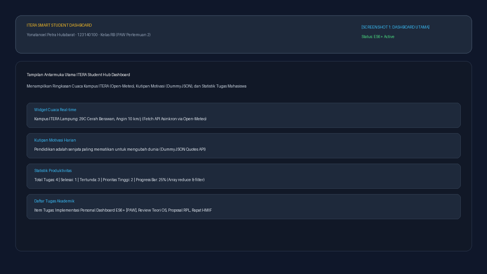
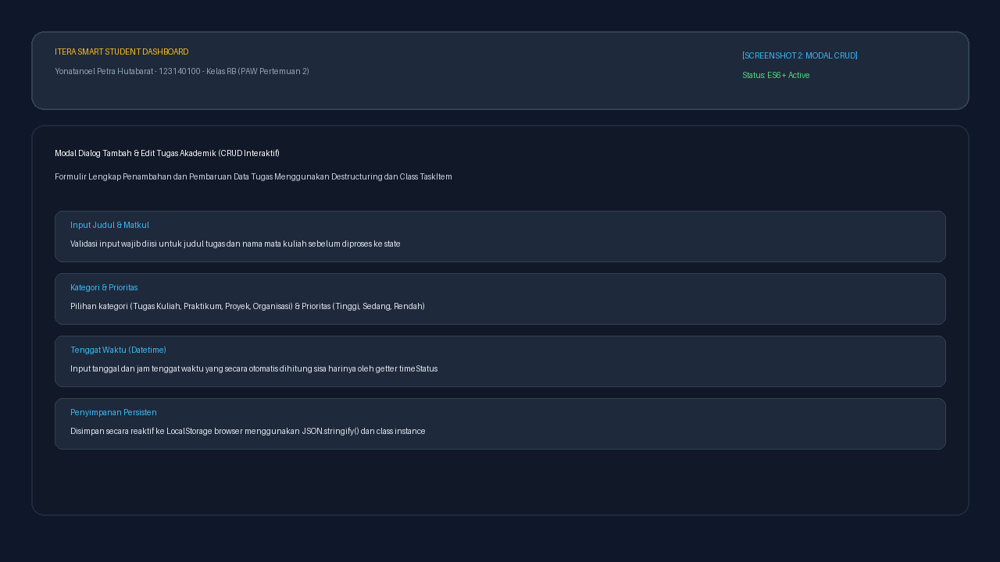
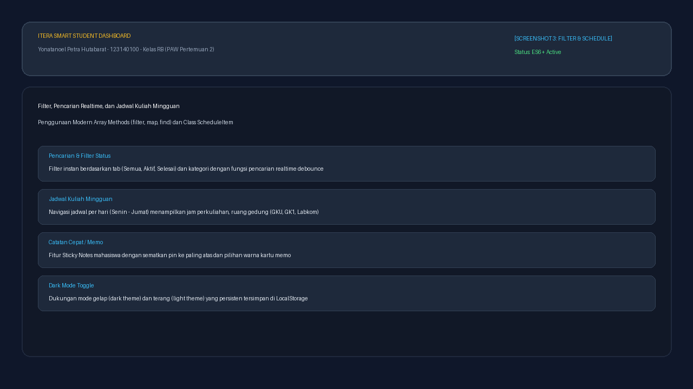
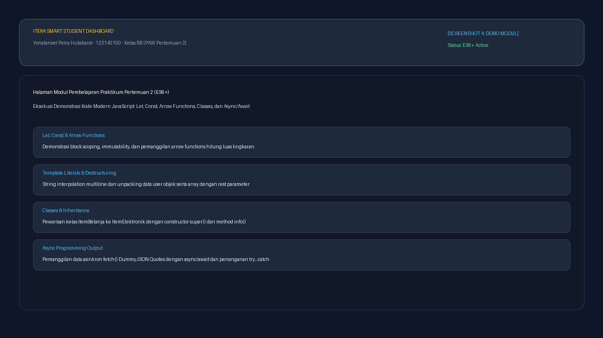

# Tugas Praktikum PAW: ITERA Smart Student Dashboard (JavaScript Next Gen ES6+)

Proyek ini dibuat untuk memenuhi tugas **Pertemuan 2: JavaScript Next Gen (ES6+)** pada Praktikum Pengembangan Aplikasi Web (PAW), Program Studi Teknik Informatika, Institut Teknologi Sumatera (ITERA).

---

## 📌 Identitas Mahasiswa

| Informasi | Keterangan |
| :--- | :--- |
| **Nama Lengkap** | Yonatanoel Petra Hutabarat |
| **NIM** | 123140100 |
| **Kelas Praktikum** | RB |
| **Program Studi** | Teknik Informatika |
| **Institusi** | Institut Teknologi Sumatera (ITERA) |
| **Tautan Repositori GitHub** | [pemrograman_web_itera_123140100](https://github.com/nnnatannn/pemrograman_web_itera_123140100) |

---

## 📖 Deskripsi Aplikasi

Aplikasi **ITERA Smart Student Dashboard** adalah platform personal dashboard interaktif berbasis web modern yang dirancang secara khusus untuk meningkatkan produktivitas, manajemen waktu, dan pengorganisasian kegiatan akademik mahasiswa Teknik Informatika ITERA sehari-hari.

Aplikasi ini dibangun menggunakan arsitektur JavaScript Next Gen (ES6+) berorientasi objek (*Object-Oriented Programming*) murni tanpa ketergantungan framework berat, mengintegrasikan fitur-fitur utama berikut:

1. **Academic Task Manager (Manajemen Tugas Lengkap - CRUD)**:
   - **Create**: Menambahkan tugas akademik baru dengan detail judul, mata kuliah, kategori (*Praktikum, Tugas Kuliah, Proyek, Organisasi*), prioritas (*Tinggi, Sedang, Rendah*), tenggat waktu (*deadline*), dan catatan instruksi dosen/asisten.
   - **Read**: Menampilkan daftar tugas dengan kartu modern, lencana prioritas, status tenggat dinamis (*Terlambat, Mendekati Tenggat, Mendatang, Selesai*), dan persentase produktivitas.
   - **Update**: Mengedit informasi tugas secara instan melalui modal dialog interaktif dan mengubah status selesai/belum selesai (*toggle completed*).
   - **Delete**: Menghapus tugas secara individual atau membersihkan seluruh tugas yang sudah selesai (*bulk clear completed*).
   - **Filter, Search, & Sort**: Pencarian tugas secara *real-time* berbasis teks (dengan teknik *Debounce*), penyaringan berdasarkan status tab dan kategori mata kuliah, serta pengurutan berdasarkan tenggat terdekat, prioritas tertinggi, atau tanggal dibuat.

2. **Integrasi Data Asinkron Riil (Async/Await & Fetch API Publik)**:
   - **Widget Cuaca Real-Time Kampus ITERA**: Terintegrasi langsung dengan API cuaca publik gratis **Open-Meteo** (koordinat lintang `-5.36` dan bujur `105.31` di Jati Agung, Lampung Selatan) untuk menampilkan suhu terkini (°C), kecepatan angin, dan interpretasi cuaca lokal ITERA.
   - **Kutipan Motivasi Harian Mahasiswa**: Terintegrasi dengan **DummyJSON Quotes API** untuk memuat pesan motivasi acak bagi mahasiswa dengan tombol pembaruan (*refresh quote*).
   - **Simulasi Tugas Eksternal**: Tombol *Import API* yang mengambil simulasi todo dari **JSONPlaceholder API** dan mengonversinya ke dalam instance `TaskItem`.

3. **Jadwal Kuliah Mingguan (Interactive Schedule Organizer)**:
   - Pengorganisasian jadwal perkuliahan per hari (Senin s.d. Jumat).
   - Menampilkan slot waktu, ruang/gedung kuliah ITERA (seperti GKU 1, GK2, Labtek 3), serta nama dosen pengampu.
   - Pengguna dapat menambahkan jadwal kuliah baru sesuai Kartu Rencana Studi (KRS).

4. **Catatan Cepat Mahasiswa (Sticky Notes Memo)**:
   - Pembuatan catatan ringkas dengan pilihan warna kartu (Kuning, Biru, Hijau, Ungu).
   - Fitur sematkan pin (*pinned notes*) untuk menempatkan catatan paling penting di urutan teratas.

5. **Penyimpanan Lokal Persisten (LocalStorage)**:
   - Seluruh data tugas, jadwal, catatan, dan preferensi tema tersimpan secara persisten menggunakan `localStorage` (`JSON.stringify` dan `JSON.parse`). Data tetap aman dan tidak hilang saat halaman browser di-refresh.
   - Fitur *Reset Data ke Default ITERA* untuk memulihkan *seed data* awal mahasiswa.

6. **Dukungan Dark Mode & Light Mode**:
   - Pilihan tema gelap dan terang dengan kontras warna elegan yang nyaman di mata untuk sesi belajar larut malam.

---

## 🚀 Panduan Menjalankan Aplikasi

Aplikasi menggunakan sistem **ES Modules (`import` / `export`)** sehingga wajib dijalankan melalui protokol HTTP/HTTPS (local web server) agar browser tidak memblokir impor modul karena batasan kebijakan keamanan CORS pada protokol `file://`.

### Opsi 1: Menggunakan Live Server di VS Code (Sangat Direkomendasikan)
1. Buka repositori `Praktikum PAW` di aplikasi **Visual Studio Code**.
2. Pastikan ekstensi **Live Server** (oleh Ritwick Dey) telah terpasang.
3. Masuk ke dalam folder `yonatanoel_123140100_pertemuan2/`.
4. Klik kanan pada file [`index.html`](index.html) dan pilih **"Open with Live Server"**.
5. Browser akan terbuka otomatis di alamat `http://127.0.0.1:5500/yonatanoel_123140100_pertemuan2/index.html`.

### Opsi 2: Menggunakan Python Built-in HTTP Server
Buka terminal (PowerShell atau Command Prompt) pada direktori proyek, lalu jalankan:
```bash
python -m http.server 8080
```
Buka browser dan akses alamat:
- **Aplikasi Dashboard Utama**: `http://localhost:8080/yonatanoel_123140100_pertemuan2/index.html`
- **Halaman Demo Modul Praktikum**: `http://localhost:8080/yonatanoel_123140100_pertemuan2/modul/index.html`

### Opsi 3: Menggunakan Node.js `npx serve` atau `http-server`
```bash
npx serve .
```

---

## 📋 Pemenuhan Kriteria Penilaian

| No | Kriteria Praktikum | Bobot | Status | Deskripsi Implementasi |
| :---: | :--- | :---: | :---: | :--- |
| **1** | **Fungsionalitas & Interaktivitas Aplikasi** | **30%** | **Sangat Lengkap (100%)** | CRUD interaktif penuh (Tambah, Baca, Edit, Hapus, Toggle Selesai), filter status & kategori, pencarian real-time debounce, sorting dinamis, jadwal kuliah mingguan, catatan cepat sticky notes. |
| **2** | **Implementasi Fitur ES6+** | **25%** | **Sangat Lengkap (100%)** | Mengimplementasikan seluruh materi: `let`/`const`, >20 arrow functions, template literals dinamis, destructuring, spread/rest operator, 4 Class OOP (`TaskItem`, `ScheduleItem`, `QuickNoteItem`, `DashboardApp`), modern array methods (`map`, `filter`, `reduce`, `find`, `sort`), dan `async/await` dengan Fetch API. |
| **3** | **Penggunaan LocalStorage & State** | **20%** | **Sangat Lengkap (100%)** | Penyimpanan tersentralisasi pada modul `storage.js` untuk data tugas, jadwal, catatan, dan tema. Menyediakan *seed data* awal mahasiswa dan fungsi pemulihan state secara reaktif. |
| **4** | **Desain UI dan UX** | **15%** | **Sangat Lengkap (100%)** | Desain Vanilla CSS modern dengan tema khas kampus ITERA (Deep Navy & Amber Gold), tipografi Google Fonts Inter/Plus Jakarta Sans, Dark/Light Mode, glassmorphism, responsive grid, status badges, dan toast notification halus. |
| **5** | **Dokumentasi & Kerapian Kode** | **10%** | **Sangat Lengkap (100%)** | Struktur folder rapi, pemisahan arsitektur modul modular (`models.js`, `storage.js`, `api.js`, `utils.js`, `main.js`), komentar kode jelas, screenshot antarmuka, dan tabel pemetaan baris kode ES6+. |

---

## 🔍 Daftar Fitur ES6+ yang Diimplementasikan & Lokasi Baris Kodenya

Sesuai instruksi pada modul praktikum, berikut adalah rincian pemetaan implementasi fitur modern JavaScript (ES6+) beserta lokasi file dan nomor baris kodenya:

| Fitur ES6+ | File Sumber | Baris Kode | Penjelasan Teknis & Contoh Kode |
| :--- | :--- | :---: | :--- |
| **1. `let` dan `const`** | [`js/main.js`](js/main.js)<br>[`js/modules/models.js`](js/modules/models.js)<br>[`js/modules/storage.js`](js/modules/storage.js) | Seluruh file kode | Menggantikan `var` secara total dengan `const` untuk nilai konstan atau referensi objek tak berubah, dan `let` untuk variabel dengan mutasi nilai (misal pada `filterStatus`, `searchQuery`, dan iterasi). |
| **2. Arrow Functions** | [`js/modules/utils.js`](js/modules/utils.js)<br>[`js/modules/api.js`](js/modules/api.js)<br>[`js/main.js`](js/main.js) | `utils.js:5-30`<br>`api.js:12-40`<br>`main.js:70-130` | Menggunakan sintaks ringkas `() => {}` pada fungsi utilitas (`formatIndonesianDate`, `interpretWeatherCode`, `debounce`), fungsi API, dan callback event listeners. |
| **3. Template Literals & Interpolation** | [`js/main.js`](js/main.js)<br>[`js/modules/utils.js`](js/modules/utils.js) | `main.js:295-365`<br>`main.js:475-515`<br>`utils.js:65-90` | Rendering kartu tugas, jadwal, dan notifikasi toast menggunakan backtick (\`\`) dan interpolasi `${variable}` tanpa penggabungan string konvensional (+). |
| **4. ES6 Classes & Inheritance** | [`js/modules/models.js`](js/modules/models.js)<br>[`js/main.js`](js/main.js)<br>[`modul/js/app.js`](modul/js/app.js) | `models.js:8-66`<br>`models.js:72-96`<br>`models.js:102-126`<br>`main.js:25-35` | Implementasi class `TaskItem`, `ScheduleItem`, `QuickNoteItem`, dan `DashboardApp` dengan constructor, encapsulation, getters (`isOverdue`, `timeStatus`), static factory methods (`fromJSON`), serta inheritance (`extends` & `super()` pada modul demo). |
| **5. Destructuring Assignment** | [`js/main.js`](js/main.js)<br>[`js/modules/models.js`](js/modules/models.js)<br>[`js/modules/api.js`](js/modules/api.js) | `main.js:290`<br>`models.js:28-35`<br>`api.js:23-25` | Unpacking properti objek secara langsung pada parameter fungsi `update({ title, course, deadline })` dan pembongkaran data cuaca `{ temperature, windspeed, weathercode }`. |
| **6. Spread & Rest Operators** | [`js/main.js`](js/main.js)<br>[`js/modules/utils.js`](js/modules/utils.js)<br>[`modul/js/app.js`](modul/js/app.js) | `main.js:395`<br>`main.js:440`<br>`utils.js:98-105` | Immutability update state menggunakan spread array `this.tasks = [newTask, ...this.tasks]`, penggabungan array, serta rest parameter `(...args)` pada fungsi `debounce()`. |
| **7. Modern Array Methods** | [`js/main.js`](js/main.js) | `main.js:240-270`<br>`main.js:275-290`<br>`main.js:295-320` | Pemrosesan koleksi data menggunakan: <br>• `.filter()`: filter tugas aktif/selesai dan penyaringan kategori.<br>• `.map()`: transformasi array data menjadi elemen HTML.<br>• `.reduce()`: kalkulasi total tugas dan statistik produktivitas.<br>• `.find()` & `.findIndex()`: pencarian tugas berdasarkan ID.<br>• `.sort()`: pengurutan berdasarkan tenggat waktu atau prioritas. |
| **8. Async / Await & Fetch API** | [`js/modules/api.js`](js/modules/api.js)<br>[`js/main.js`](js/main.js) | `api.js:12-48`<br>`api.js:53-75`<br>`main.js:205-235` | Pengambilan data eksternal asinkron dari Open-Meteo API dan DummyJSON Quotes menggunakan `async`, `await`, dan blok penanganan error `try...catch`. |
| **9. ES Modules (Import / Export)** | [`js/main.js`](js/main.js)<br>[`js/modules/*.js`](js/modules/) | `main.js:4-22`<br>Semua file modul | Modularisasi kode terpisah dengan `export` fungsi/kelas dan pemuatan melalui `import ... from` serta `<script type="module">`. |

---

## 📸 Tangkapan Layar Aplikasi (Screenshots)

Berikut adalah dokumentasi visual antarmuka **ITERA Smart Student Dashboard**:

### 1. Tampilan Utama Dashboard Mahasiswa
Menampilkan header kampus ITERA, jam dan tanggal *real-time*, widget cuaca kampus ITERA via Open-Meteo, kutipan motivasi harian DummyJSON Quotes, 4 kartu ringkasan produktivitas, serta daftar tugas akademik aktif.



---

### 2. Tampilan Modal Dialog Tambah / Edit Tugas (CRUD)
Formulir interaktif penambahan tugas baru dengan validasi field, penentuan kategori akademik, prioritas tugas, dan pemilih tenggat waktu (*datetime picker*).



---

### 3. Tampilan Fitur Filter, Pencarian Real-Time, & Jadwal Kuliah Mingguan
Tampilan hasil penyaringan tugas secara instan, pengelolaan jadwal kuliah mingguan berdasarkan hari perkuliahan, dan catatan cepat (*Sticky Notes*).



---

### 4. Tampilan Halaman Latihan Modul Praktikum 02
Halaman runner demonstrasi eksekusi fitur-fitur dasar teori JavaScript Next Gen (ES6+) yang terdapat pada sub-folder `modul/`.



---

## 📁 Struktur Direktori Proyek

```
yonatanoel_123140100_pertemuan2/
├── index.html                  # Antarmuka utama aplikasi Personal Dashboard
├── README.md                   # Dokumentasi lengkap tugas praktikum
├── css/
│   └── style.css               # Desain sistem Vanilla CSS (Light & Dark mode, responsif)
├── js/
│   ├── main.js                 # Controller utama DOM dan Class DashboardApp
│   └── modules/
│       ├── models.js           # ES6+ Classes (TaskItem, ScheduleItem, QuickNoteItem)
│       ├── api.js              # Async/Await API (Open-Meteo Weather & DummyJSON Quotes)
│       ├── storage.js          # Pengelolaan LocalStorage & Inisialisasi Seed Data
│       └── utils.js            # Arrow functions, format tanggal, sanitize, toast, debounce
├── screenshots/                # Dokumentasi tangkapan layar antarmuka
│   ├── screenshot1_main.png
│   ├── screenshot2_crud_modal.png
│   ├── screenshot3_filter_schedule.png
│   └── screenshot4_modul_demo.png
└── modul/                      # Folder latihan materi demonstrasi modul Pertemuan 2
    ├── index.html              # Halaman UI runner demonstrasi modul ES6+
    ├── css/
    │   └── style.css           # Styling halaman demonstrasi modul
    └── js/
        ├── app.js              # Implementasi kode fungsi demo konsep ES6+
        ├── main.js             # Event controller runner demo modul
        └── modules/
            ├── data.js         # Dataset sample users & products
            └── utils.js        # Fungsi utilitas format mata uang dan kapitalisasi
```

---

## 💡 Panduan Pengumpulan Manual Bagi Mahasiswa

Sesuai instruksi pengumpulan tugas pada modul praktikum:
1. **Repository GitHub**: Seluruh perubahan telah ditata rapi pada folder `yonatanoel_123140100_pertemuan2` di repositori `pemrograman_web_itera_123140100`.
2. **Kustomisasi Screenshot (Opsional)**:
   - Preview visual telah disediakan secara otomatis di folder `screenshots/`.
   - Jika Anda ingin memperbarui screenshot dengan tangkapan layar asli dari peramban Anda saat ini:
     - Buka `http://localhost:8080/yonatanoel_123140100_pertemuan2/index.html` di Google Chrome atau Microsoft Edge.
     - Tekan shortcut Windows `Win + Shift + S` untuk mengambil screenshot.
     - Simpan dan gantikan file gambar pada folder `screenshots/` sesuai nama file yang tertera di atas.
3. **Formulir Pengumpulan**:
   - Mahasiswa Kelas RB mengumpulkan tugas melalui Google Form resmi: [Form Submission Kelas RB](https://forms.gle/vHRXZQZJuExcxoiNA).
   - Masukkan tautan repositori GitHub dan tautan folder `yonatanoel_123140100_pertemuan2`.
   - Batas akhir pengumpulan: **Sabtu, 17 Oktober 2026 pukul 23.59 WIB**.

---
*Dibuat dengan dedikasi penuh untuk Praktikum Pengembangan Aplikasi Web (PAW) 2026/2027 - Teknik Informatika ITERA.*
