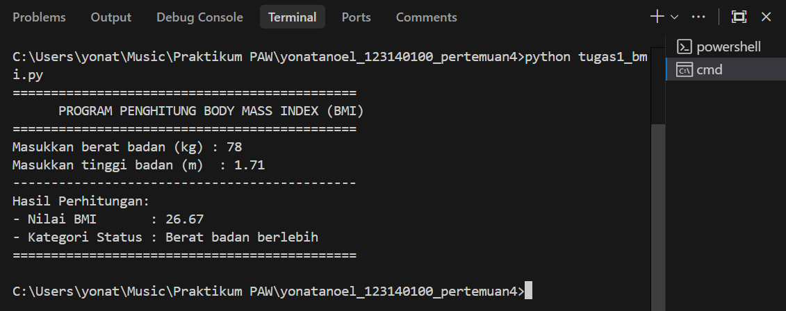
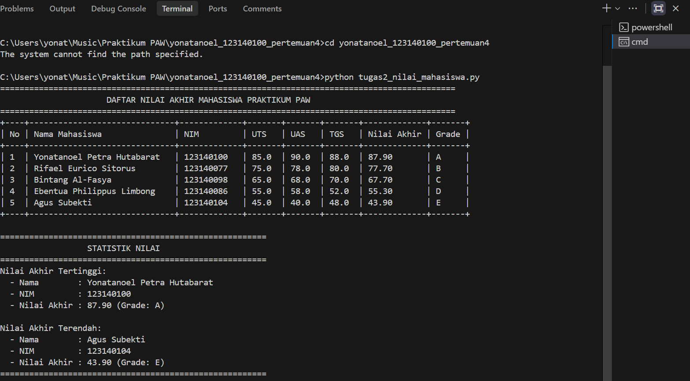
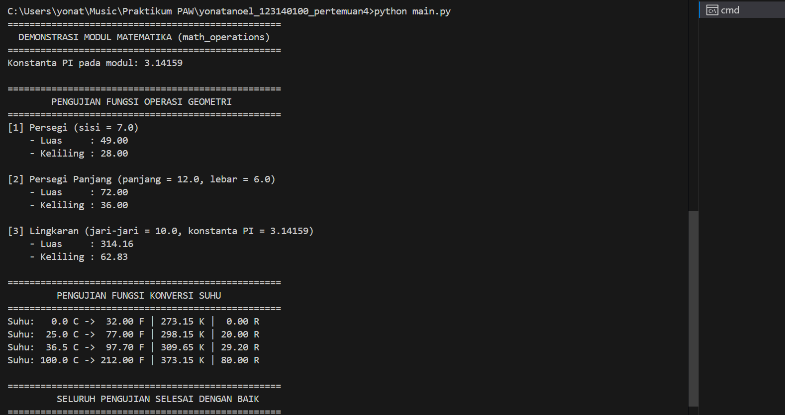

# Tugas Praktikum Pengembangan Aplikasi Web (PAW)
> **Pertemuan 04:** Dasar Pemrograman Python (Variabel, Struktur Kendali, Modularitas Fungsi, Koleksi Data, dan Modul)  
> **Teknik Informatika — Institut Teknologi Sumatera (ITERA)**

---

## 👤 Identitas Praktikan
- **Nama Lengkap:** Yonatanoel Petra Hutabarat
- **NIM:** 123140100
- **Mata Kuliah:** Praktikum Pengembangan Aplikasi Web (PAW)
- **Tahun Ajaran:** 2026/2027 (Gasal)
- **Repositori Git:** `pemrograman_web_itera_123140100`
- **Folder Tugas:** `yonatanoel_123140100_pertemuan4`

---

## 📁 Struktur Folder Tugas

```text
yonatanoel_123140100_pertemuan4/
├── .gitignore
├── README.md
├── tugas1_bmi.py
├── tugas2_nilai_mahasiswa.py
├── math_operations.py
├── main.py
└── screenshots/
    ├── screenshot_tugas1.png
    ├── screenshot_tugas2.png
    └── screenshot_tugas3.png
```

---

## 📝 Penjelasan Program & Alur Kerja

### 1. Soal 1: Program Penghitung BMI (`tugas1_bmi.py`)
- **Deskripsi:** Program konsol interaktif untuk menghitung indeks massa tubuh (*Body Mass Index* / BMI) berdasarkan berat badan (kg) dan tinggi badan (m) yang diinputkan pengguna melalui terminal.
- **Alur Kerja & Logika:**
  1. Pengguna memasukkan berat badan (kg) dan tinggi badan (m) melalui fungsi `input()`.
  2. Dilakukan penanganan kesalahan (*error handling*) dengan blok `try-except` untuk memastikan input berupa angka valid dan nilainya lebih besar dari 0.
  3. Menghitung nilai BMI dengan rumus:
     $$\text{BMI} = \frac{\text{berat}}{\text{tinggi}^2}$$
  4. Menentukan kategori status berat badan menggunakan struktur percabangan `if-elif-else`:
     - $\text{BMI} < 18.5$ : **Berat badan kurang**
     - $18.5 \le \text{BMI} < 25$ : **Berat badan normal**
     - $25 \le \text{BMI} < 30$ : **Berat badan berlebih**
     - $\text{BMI} \ge 30$ : **Obesitas**
  5. Menampilkan hasil perhitungan dengan format dua desimal (`f"{bmi:.2f}"`) beserta kategori statusnya.

---

### 2. Soal 2: Pengelolaan Data Nilai Mahasiswa (`tugas2_nilai_mahasiswa.py`)
- **Deskripsi:** Program untuk mengolah data nilai mahasiswa menggunakan struktur data koleksi `list` yang berisi sekumpulan `dictionary`.
- **Alur Kerja & Logika:**
  1. Data mahasiswa disimpan dalam bentuk `list` berisi minimal 5 `dictionary`, masing-masing dengan kunci: `nama`, `nim`, `nilai_uts`, `nilai_uas`, dan `nilai_tugas`.
  2. Dilakukan perulangan `for` untuk menghitung nilai akhir dengan bobot persentase:
     $$\text{Nilai Akhir} = (30\% \times \text{UTS}) + (40\% \times \text{UAS}) + (30\% \times \text{Tugas})$$
  3. Menentukan grade huruf berdasarkan skala:
     - Grade `A` : Nilai Akhir $\ge 80$
     - Grade `B` : $70 \le \text{Nilai Akhir} < 80$
     - Grade `C` : $60 \le \text{Nilai Akhir} < 70$
     - Grade `D` : $50 \le \text{Nilai Akhir} < 60$
     - Grade `E` : Nilai Akhir $< 50$
  4. Data ditampilkan dalam bentuk tabel rapi pada terminal menggunakan format perataan *f-string*.
  5. Mencari dan mencetak informasi mahasiswa yang mendapatkan nilai akhir tertinggi dan terendah menggunakan fungsi `max()` dan `min()`.

---

### 3. Soal 3: Modul Matematika Python & Program Penggunaannya (`math_operations.py` & `main.py`)
- **A. Modul `math_operations.py`:**
  - Menyediakan konstanta nilai `PI = 3.14159`.
  - Berisi fungsi perhitungan luas dan keliling untuk 3 bangun datar:
    - **Persegi:** `luas_persegi(sisi)`, `keliling_persegi(sisi)`
    - **Persegi Panjang:** `luas_persegi_panjang(panjang, lebar)`, `keliling_persegi_panjang(panjang, lebar)`
    - **Lingkaran:** `luas_lingkaran(jari_jari)`, `keliling_lingkaran(jari_jari)`
  - Berisi fungsi konversi suhu dari skala Celsius ke satuan lain:
    - `celsius_ke_fahrenheit(celsius)`: $(C \times 9/5) + 32$
    - `celsius_ke_kelvin(celsius)`: $C + 273.15$
    - `celsius_ke_reamur(celsius)`: $C \times 4/5$
  - Seluruh fungsi dilengkapi dengan *docstring* sesuai standar PEP 8.

- **B. Program Utama `main.py`:**
  - Mengimplementasikan minimal 2 cara impor:
    1. `import math_operations` (mengakses modul melalui namespace modul, misalnya `math_operations.PI` dan fungsi persegi panjang/lingkaran).
    2. `from math_operations import ...` (mengimpor fungsi secara langsung seperti `luas_persegi`, `celsius_ke_fahrenheit`, dll).
  - Menguji seluruh fungsi yang ada pada modul dengan nilai uji bervariasi dan mencetak hasil pengujian dengan rapi ke terminal.

---

## 💻 Panduan Menjalankan Program

Pastikan Python 3 sudah terinstal di komputer. Buka terminal atau Command Prompt pada direktori tugas:

```bash
cd yonatanoel_123140100_pertemuan4
```

### 1. Menjalankan Soal 1 (Penghitung BMI)
```bash
python tugas1_bmi.py
```
Masukkan nilai berat badan (kg) dan tinggi badan (m) saat diminta oleh program.

### 2. Menjalankan Soal 2 (Pengelolaan Nilai Mahasiswa)
```bash
python tugas2_nilai_mahasiswa.py
```
Program akan langsung menampilkan tabel nilai mahasiswa serta statistik nilai tertinggi dan terendah.

### 3. Menjalankan Soal 3 (Modul Matematika & Program Utama)
```bash
python main.py
```
Program akan menjalankan seluruh pengujian fungsi geometri dan konversi suhu dari modul `math_operations.py`.

---

## 📷 Dokumentasi Hasil Eksekusi (Screenshots)

Berikut adalah bukti tangkapan layar hasil eksekusi program di terminal:

### 1. Bukti Eksekusi Soal 1 (`tugas1_bmi.py`)


### 2. Bukti Eksekusi Soal 2 (`tugas2_nilai_mahasiswa.py`)


### 3. Bukti Eksekusi Soal 3 (`main.py`)


