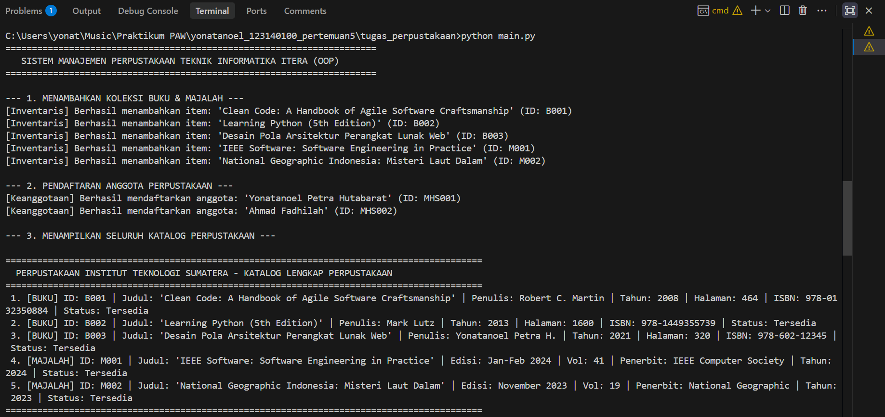
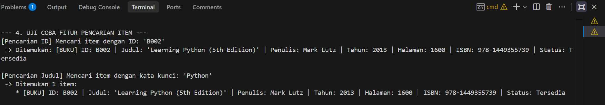
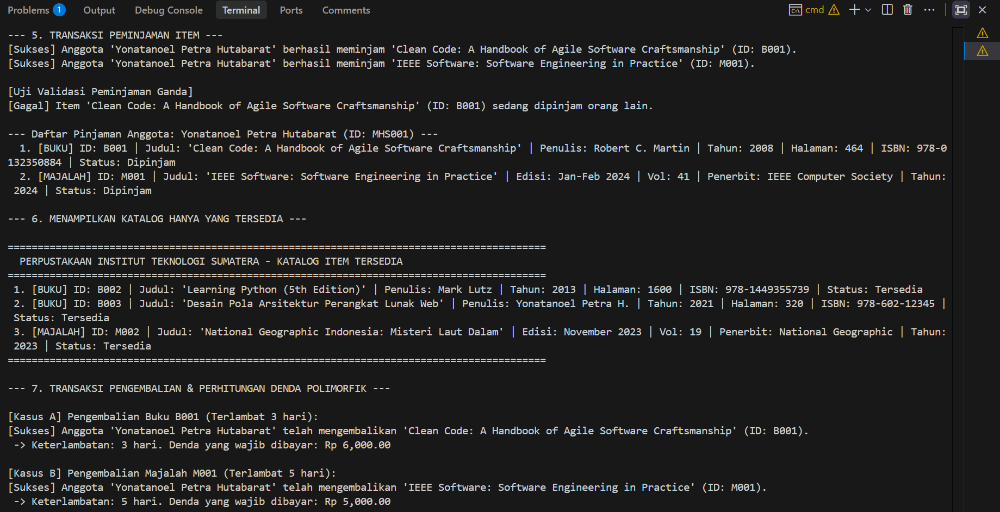
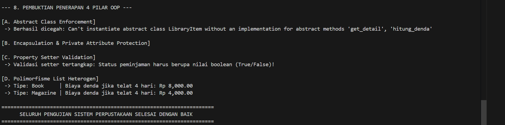

# Tugas Praktikum Pengembangan Aplikasi Web (PAW)
> **Pertemuan 05:** Pemrograman Berorientasi Objek (OOP) Menggunakan Python  
> **Teknik Informatika — Institut Teknologi Sumatera (ITERA)**

---

## 👤 Identitas Praktikan
- **Nama Lengkap:** Yonatanoel Petra Hutabarat
- **NIM:** 123140100
- **Kelas Praktikum:** RB
- **Mata Kuliah:** Praktikum Pengembangan Aplikasi Web (PAW)
- **Tahun Ajaran:** 2026/2027 (Gasal)
- **Repositori Git:** `pemrograman_web_itera_123140100`
- **Folder Tugas:** `yonatanoel_123140100_pertemuan5`

---

## 📁 Struktur Berkas Proyek

```text
yonatanoel_123140100_pertemuan5/
├── latihan/
│   ├── 01_everything_is_object.py
│   ├── 01_procedural_vs_oop.py
│   ├── 02_class_object.py
│   ├── 03_inheritance.py
│   ├── 04_encapsulation.py
│   ├── 05_polymorphism.py
│   └── 06_abstract_class.py
├── tugas_perpustakaan/
│   ├── library_item.py
│   ├── member.py
│   ├── library.py
│   └── main.py
├── screenshots/
│   ├── screenshot_katalog.png
│   ├── screenshot_pencarian.png
│   ├── screenshot_transaksi.png
│   └── screenshot_pembuktian_oop.png
├── README.md
└── .gitignore
```

---

## 📚 Deskripsi Program & Penerapan 4 Pilar OOP

Program tugas utama adalah **Sistem Manajemen Perpustakaan Sederhana** yang mengimplementasikan empat pilar utama *Object-Oriented Programming* (OOP) dengan Python:

### 1. Abstract Class & Inheritance (Pewarisan)
- **Abstract Base Class (`LibraryItem`):** Menggunakan modul `abc` (`ABC` dan `@abstractmethod`) sebagai cetak biru fundamental untuk seluruh jenis koleksi perpustakaan. Kelas ini tidak dapat diinstansiasi secara langsung.
- **Subclass `Book` & `Magazine`:** Mewarisi atribut umum (`item_id`, `judul`, `tahun_terbit`) dan metode konkret (`pinjam()`, `kembalikan()`) dari `LibraryItem` melalui pemanggilan `super().__init__()`.
- **Implementasi Spesifik:**
  - `Book` memiliki atribut unik `penulis`, `isbn`, `jumlah_halaman`, dan denda keterlambatan Rp 2.000 / hari.
  - `Magazine` memiliki atribut unik `edisi`, `volume`, `penerbit`, dan denda keterlambatan Rp 1.000 / hari.

### 2. Encapsulation (Enkapsulasi & Access Modifiers)
- **Protected Attributes (`_item_id`, `_judul`, `_tahun_terbit`):** Diberi awalan satu garis bawah sebagai konvensi atribut yang hanya diakses oleh kelas induk dan kelas turunannya.
- **Private Attributes (`__is_dipinjam`, `__daftar_pinjaman`, `__koleksi`, `__anggota`):** Diberi awalan dua garis bawah (*name mangling*) untuk memproteksi integritas data dari modifikasi langsung di luar kelas.
- **Modern Property Decorator (`@property`):**
  - Getter: `@property def is_dipinjam(self)` untuk membaca status secara aman.
  - Setter: `@is_dipinjam.setter` menyisipkan validasi tipe data (wajib bernilai `bool`) sebelum data diubah.
  - Getter pada `Member.daftar_pinjaman` mengembalikan salinan `list` sehingga koleksi internal tidak dapat dimutasi secara ilegal dari luar.

### 3. Polymorphism (Polimorfisme & Dynamic Dispatch)
- **Overriding Abstract Method `get_detail()`:** Baik `Book` maupun `Magazine` mengimplementasikan format deskripsi yang disesuaikan dengan jenis item masing-masing. Ketika `Library.tampilkan_katalog()` memproses daftar heterogen `[Book, Magazine]`, Python secara dinamis mengeksekusi metode yang sesuai tanpa pengecekan tipe manual.
- **Overriding Abstract Method `hitung_denda()`:** Menghitung tarif denda yang berbeda secara otomatis berdasarkan jenis objek saat pengembalian terlambat.

### 4. Fungsionalitas Sistem Perpustakaan
- Menambahkan koleksi item buku dan majalah ke inventaris.
- Mendaftarkan anggota perpustakaan (`Member`).
- Menampilkan seluruh katalog dan filter katalog item yang sedang tersedia.
- Pencarian item berdasarkan ID unik dan berdasarkan kata kunci pada judul.
- Transaksi peminjaman item oleh anggota dengan validasi ketersediaan (mencegah peminjaman ganda).
- Transaksi pengembalian item disertai kalkulasi denda keterlambatan secara otomatis.

---

## 💻 Panduan Menjalankan Program

Pastikan Python 3 sudah terpasang di komputer Anda. Buka terminal atau Command Prompt pada root repositori, lalu arahkan ke direktori tugas pertemuan 5:

```bash
cd yonatanoel_123140100_pertemuan5
```

### 1. Menjalankan Tugas Utama (Sistem Perpustakaan)
Masuk ke direktori `tugas_perpustakaan` dan jalankan `main.py`:
```bash
cd tugas_perpustakaan
python main.py
```

### 2. Menjalankan Berkas Latihan / Hands-on (Opsional)
Untuk menguji masing-masing materi hands-on modul:
```bash
cd ../latihan
python 01_everything_is_object.py
python 01_procedural_vs_oop.py
python 02_class_object.py
python 03_inheritance.py
python 04_encapsulation.py
python 05_polymorphism.py
python 06_abstract_class.py
```

---

## 📷 Dokumentasi Hasil Eksekusi (Screenshots)

Berikut adalah bukti tangkapan layar terminal saat program `main.py` dijalankan:

### 1. Menambahkan Item & Menampilkan Seluruh Katalog


### 2. Pengujian Fitur Pencarian Item (Berdasarkan ID & Judul)


### 3. Transaksi Peminjaman & Pengembalian dengan Denda


### 4. Pembuktian Penegakan Prinsip OOP (Abstract, Encapsulation, Polymorphism)

